# Pasos seguidos de los laboratorios

## Índice

- [Laboratorio 2: CI/CD del backend Banco UdeA](<#laboratorio-2-cicd-del-backend-banco-udea>)
- [Laboratorio MCP: tareas y supermercado](<#laboratorio-mcp-tareas-y-supermercado>)

# Laboratorio 2: CI/CD del backend Banco UdeA

Publiqué el backend del banco, hecho con Spring Boot 4.1.1 y Java 17, usando GitHub Actions, SonarCloud, Docker Hub y Render. La persistencia la dejé en H2 en memoria, así que no necesité un servidor de base de datos externo.

## 1. Cambios realizados al proyecto

- En el `pom.xml` agregué JaCoCo, definí el `finalName` como `banco`, puse las propiedades de Sonar y dejé H2 con alcance `runtime`.
- En `application.properties` configuré la conexión para que use H2 en memoria por defecto, y dejé `DB_URL`, `DB_USER`, `DB_PASSWORD` y `PORT` como variables de entorno que se pueden sobrescribir. Quité el driver y el dialecto de MySQL que estaban fijos para que Spring Boot e Hibernate los detecten a partir de la URL.
- Creé `BancoServicesTests` con pruebas de clientes y transferencias sobre los servicios.
- Creé el `Dockerfile` y el archivo `.github/workflows/build.yml`, con un pipeline de cinco jobs: tests, sonar, build, docker y deploy.

Como los datos viven en memoria, se pierden cuando el contenedor se reinicia, lo que en el plan Free de Render pasa después de periodos de inactividad.

## 2. Pruebas locales

Antes de subir nada, ejecuté las pruebas y levanté la aplicación en mi máquina:

```shell
./mvnw clean verify
./mvnw spring-boot:run
```

Revisé el reporte de cobertura en `target/site/jacoco/index.html`.

## 3. SonarCloud

1. Entré a https://sonarcloud.io con mi cuenta de GitHub e importé este repositorio.
2. En Administration > Analysis Method desactivé Automatic Analysis.
3. En Information copié el Project Key y el Organization Key.
4. En My Account > Security generé un token.

Cuando corrió el pipeline revisé el análisis de la rama `main`, con el Quality Gate y la cobertura:

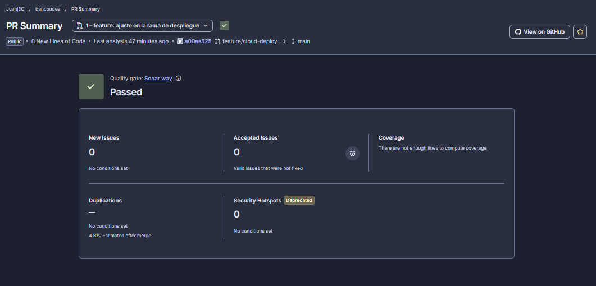

## 4. Docker Hub

1. Creé un repositorio público llamado `banco`.
2. Creé un Access Token con permisos de lectura y escritura.

El pipeline publicó la imagen con el tag `latest`:

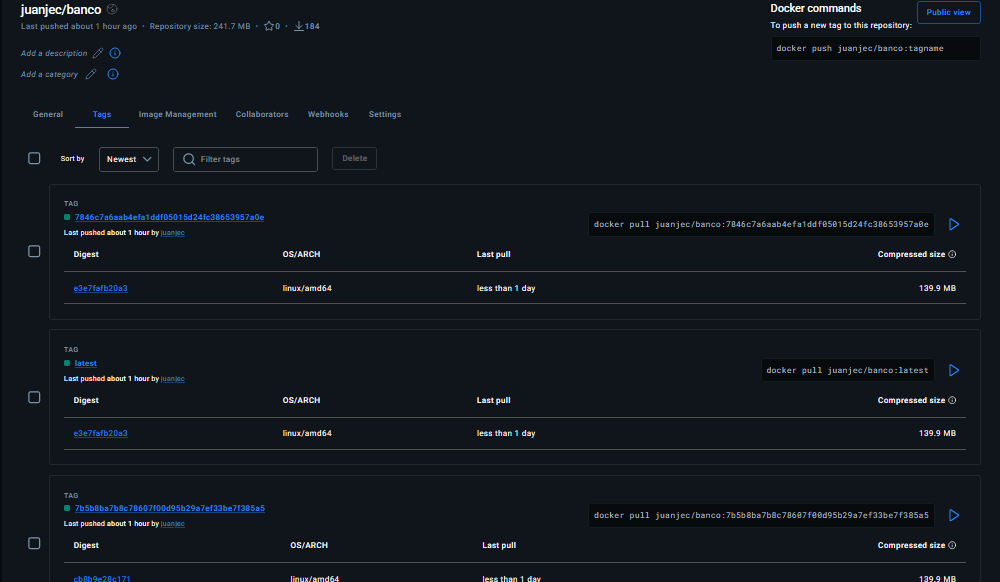

## 5. Secrets y variables en GitHub

Entré a Settings > Secrets and variables > Actions del repositorio y creé lo siguiente.

| Nombre | Tipo | Valor |
|---|---|---|
| `SONAR_TOKEN` | Secret | Token de SonarCloud |
| `DOCKER_USERNAME` | Secret | Usuario de Docker Hub |
| `DOCKER_PASSWORD` | Secret | Access token de Docker Hub |
| `RENDER_DEPLOY_HOOK_URL` | Secret | Deploy Hook del servicio en Render |
| `SONAR_PROJECT_KEY` | Variable | Project Key de SonarCloud |
| `SONAR_ORGANIZATION` | Variable | Organization Key de SonarCloud |

## 6. Primer push y publicación de la imagen

Subí los cambios a `main`:

```shell
git add .
git commit -m "Laboratorio 2"
git push origin main
```

En ese primer push el job `deploy` falló porque todavía no existía el hook de Render. Era lo esperado. Una vez configuré el hook, volví a ejecutar el pipeline y los cinco jobs (tests, sonar, build, docker y deploy) terminaron en verde:

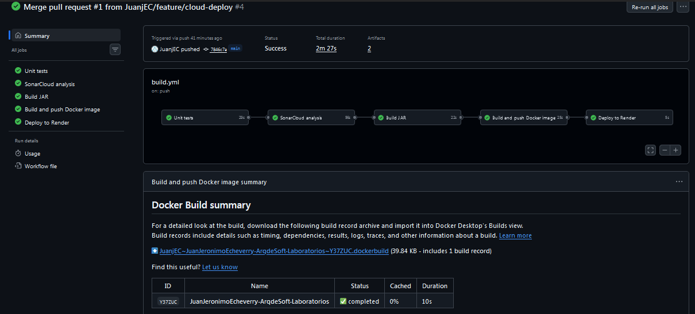

## 7. Render

1. Fui a New > Web Service > Existing Image.
2. Puse como Image path `docker.io/juanjec/banco:latest`.
3. Elegí el plan Free.
4. No agregué variables de entorno, porque `PORT` la define Render.
5. En Settings puse el Health Check Path en `/api/customers`.
6. Copié el Deploy Hook de Settings y lo guardé como el secret `RENDER_DEPLOY_HOOK_URL` en GitHub.

El servicio quedó en estado Live con su URL pública:

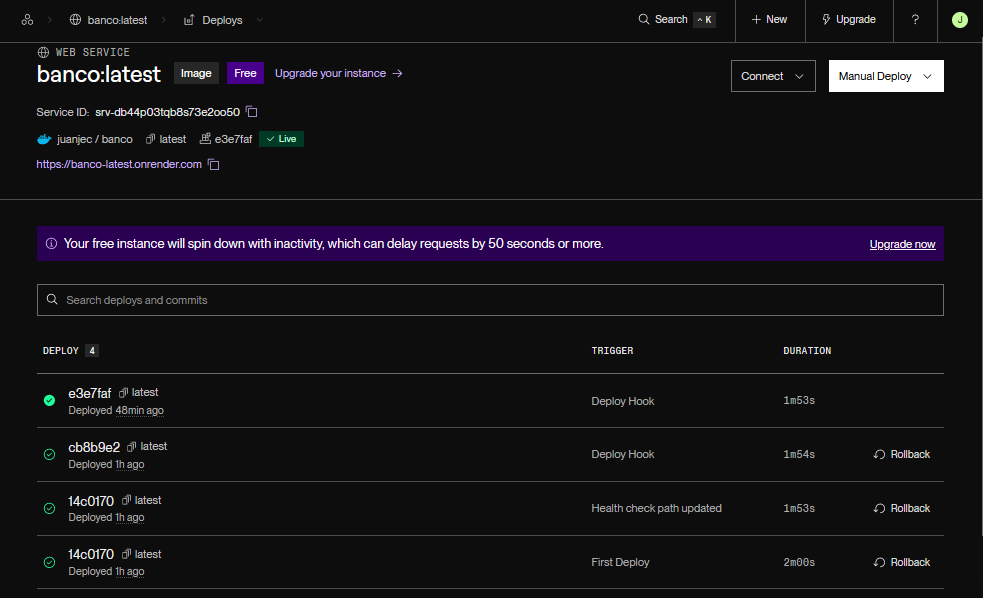

## 8. Trunk based con una segunda rama

Dejé configurada la rama `feature/cloud-deploy` en `build.yml`, bajo `on.push.branches`. Creé la rama desde `main`:

```shell
git checkout main
git pull origin main
git checkout -b feature/cloud-deploy
```

Hice un cambio agregando el README y lo subí:

```shell
git add .
git commit -m "feature: ajuste en la rama de despliegue"
git push -u origin feature/cloud-deploy
```

En GitHub abrí el Compare & pull request hacia `main`, esperé a que los checks pasaran en verde e hice el Merge pull request. El push resultante en `main` ejecutó el pipeline completo y desplegó en Render.

Este es el pull request con los checks y el merge hacia `main`:

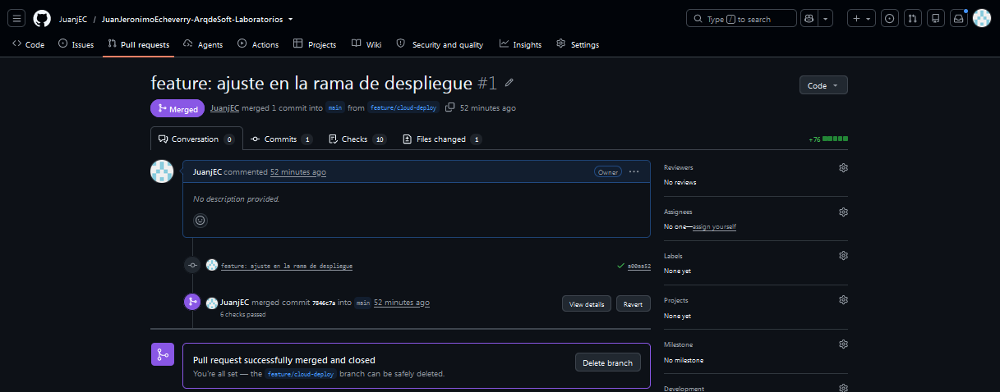

Para ver el historial de ramas ejecuté:

```shell
git log --graph --oneline --all
```

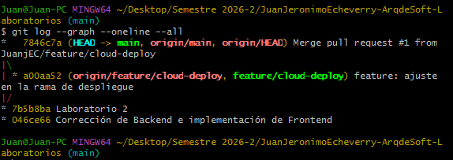

## 9. Pruebas del backend en la nube

Probé el backend desplegado con Postman, usando la URL pública de Render. Como los datos están en memoria, hice todas las peticiones seguidas. Estas son las pruebas (en la primera petición tras un rato de inactividad tardó unos segundos, porque en el plan Free Render suspende el servicio):

Primero consulté el listado de clientes, que estaba vacío:

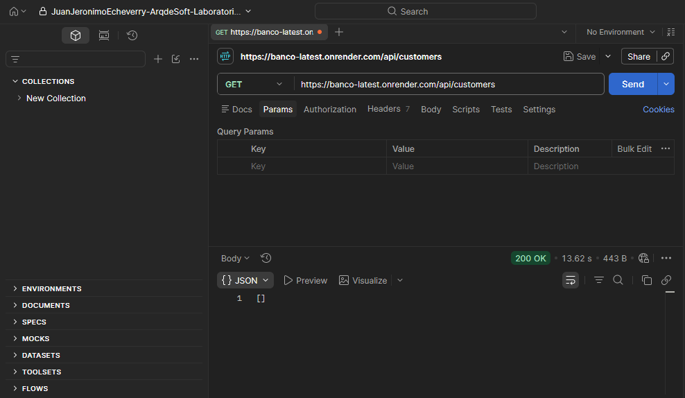

Luego creé el primer cliente:

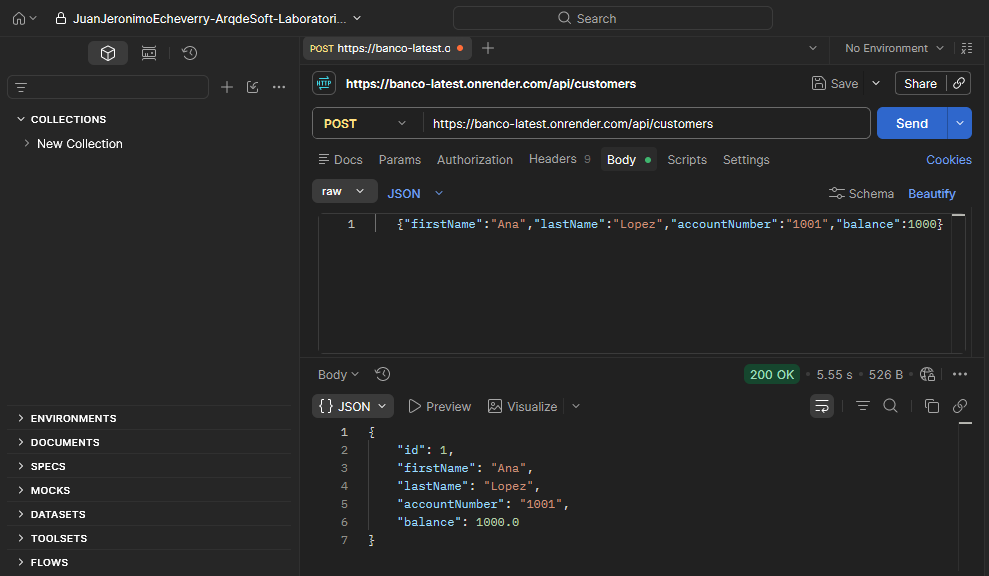

Después creé el segundo cliente:

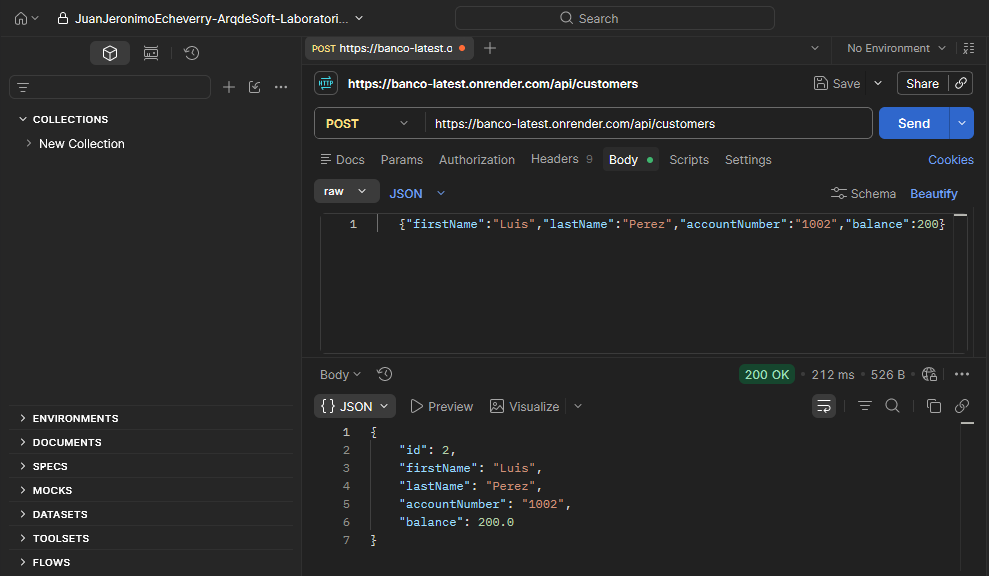

Hice una transferencia entre las dos cuentas:

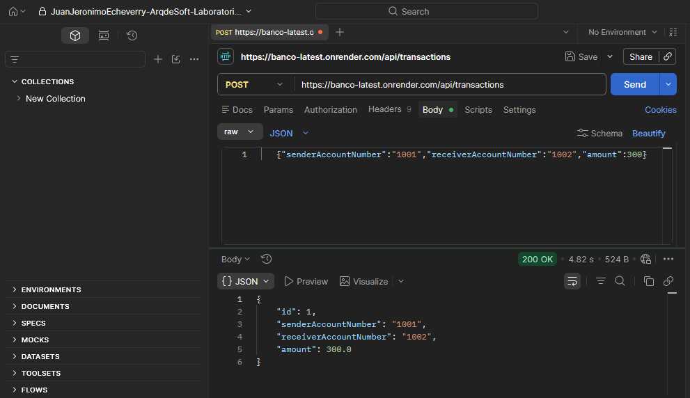

Consulté el historial de transacciones de la cuenta origen:

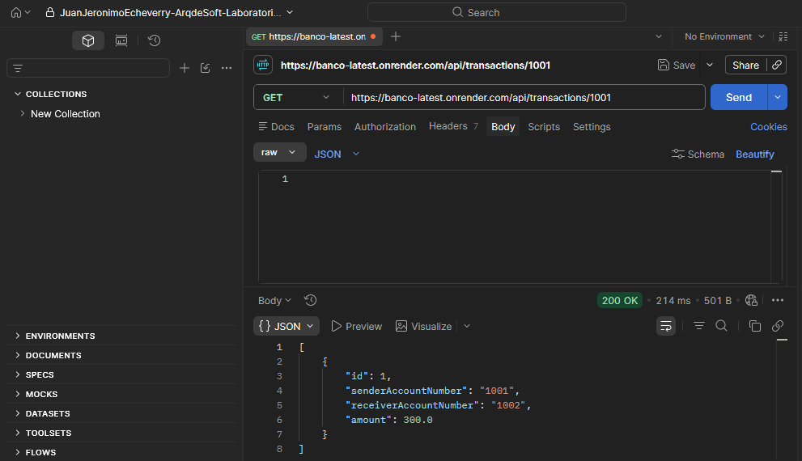

Por último volví a listar los clientes y verifiqué que los saldos quedaron actualizados:

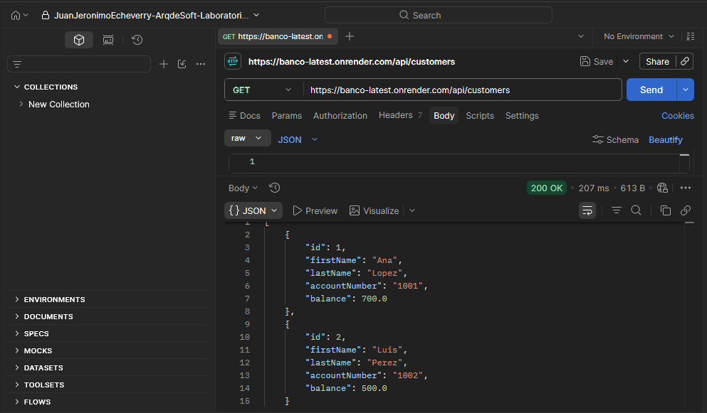

## 10. Pruebas desde el frontend

El proyecto incluye un frontend en `banco-frontend`, hecho con HTML y JavaScript plano, sin compilación. Abrí `banco-frontend/index.html` en el navegador y, en el campo API de la barra lateral, escribí la URL pública de Render en lugar de `http://localhost:8080`. El backend permite el acceso desde cualquier origen en `/api/**`, así que no hubo problemas de CORS.

Al iniciar, el listado de clientes estaba vacío:

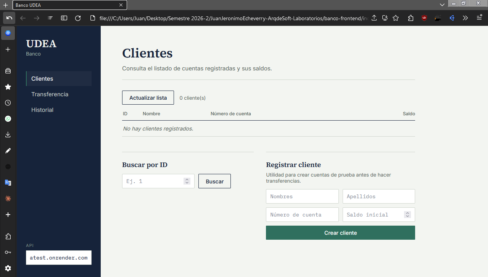

Creé el primer cliente:

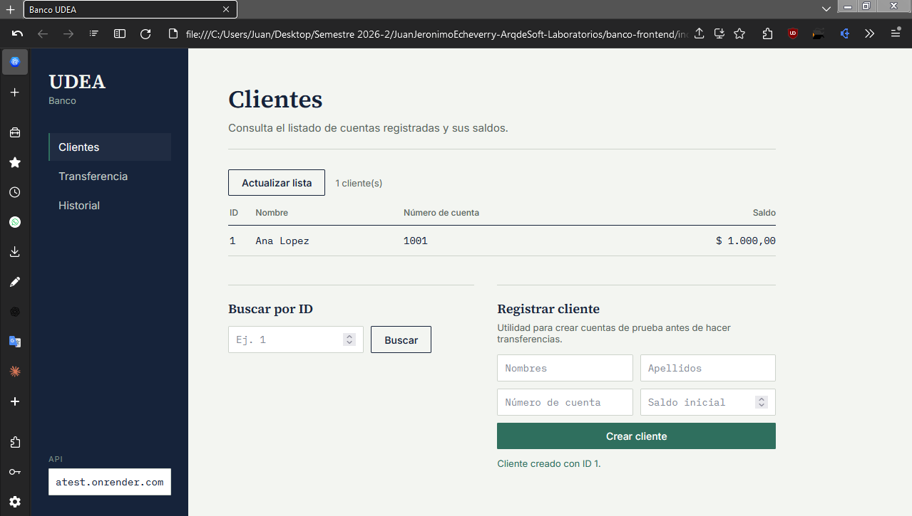

Creé el segundo cliente:

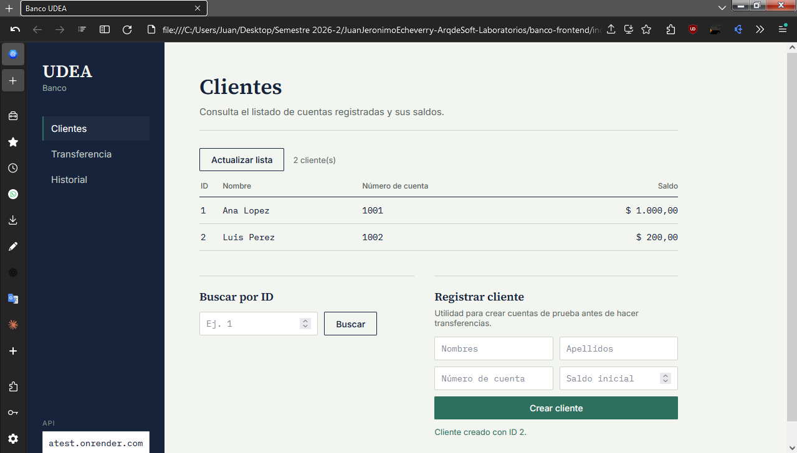

Hice una transferencia entre las cuentas:

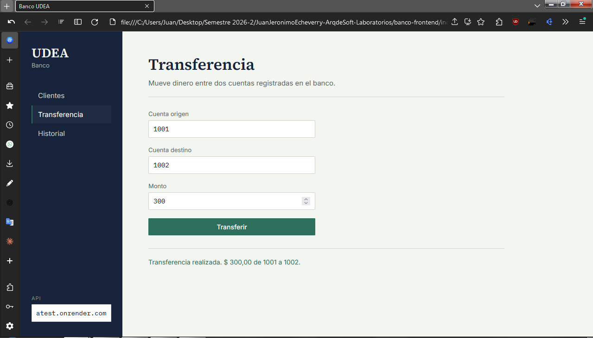

Revisé el historial de transacciones:

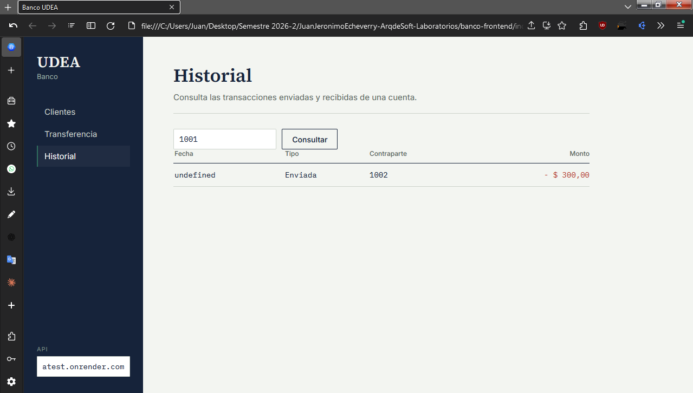

Finalmente consulté el listado de clientes con los saldos actualizados:

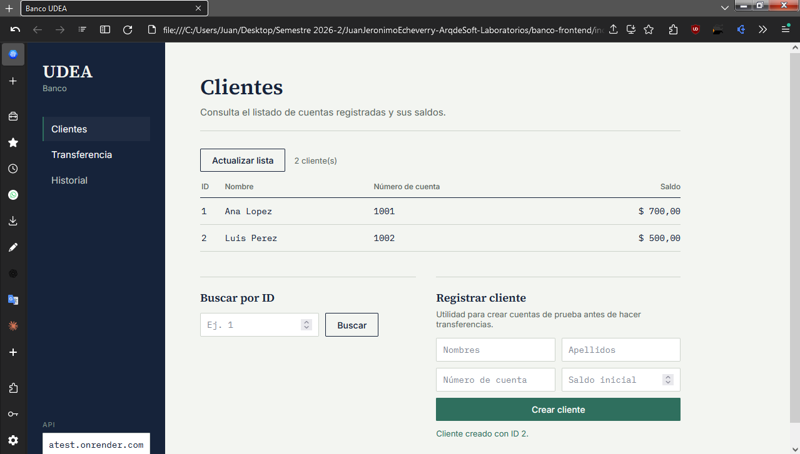

## 11. Snyk

1. Entré a https://snyk.io con mi cuenta de GitHub.
2. En Add projects elegí GitHub y seleccioné este repositorio.
3. Cuando terminó el escaneo abrí View report.

Este fue el resultado del escaneo del `pom.xml` y del `Dockerfile`:

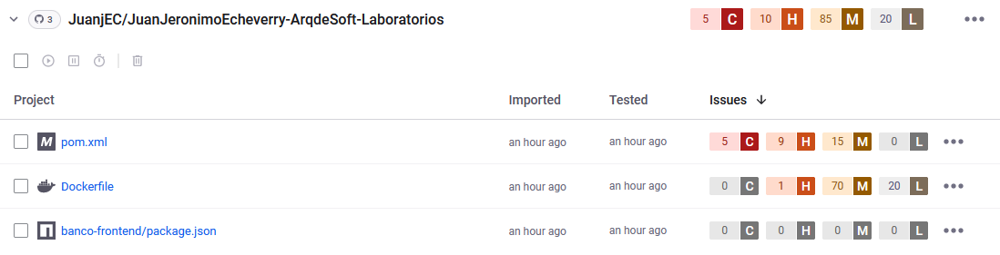

# Laboratorio MCP: tareas y supermercado

Agregué al repositorio un servidor MCP para administrar tareas y registrar pedidos de supermercado a domicilio, junto con un cliente Google ADK. Conservé el banco de los laboratorios anteriores y organicé esta implementación en [servidor-mcp](<laboratorio-mcp/servidor-mcp/pom.xml>) y [agente-mcp](<laboratorio-mcp/agente-mcp/pom.xml>). Dejé los comandos de preparación, ejecución y conexión en el [README, sección Laboratorio MCP](<README.md#laboratorio-mcp>).

## 12. Organización de los proyectos y dependencias

Configuré el [POM del servidor](<laboratorio-mcp/servidor-mcp/pom.xml>) con Spring Boot **3.5.11**, Spring AI **1.1.4**, WebMVC MCP, JPA y los drivers MySQL/H2. En el [POM del agente](<laboratorio-mcp/agente-mcp/pom.xml>) usé Google ADK y ADK Dev **1.0.0**, con Spring Boot **4.0.2**. Separé los POM para mantener compatibles las dependencias de Spring AI y ADK sin cambiar las del banco; ambos proyectos compilan para Java 21 y se ejecutan seleccionando su POM desde la raíz.

Dejé el servidor en `127.0.0.1:8088/mcp`, con transporte **Streamable HTTP**, y la interfaz ADK en `127.0.0.1:8081/dev-ui`. Así conservé el puerto 8080 para el banco y evité mezclar las configuraciones de los laboratorios.

## 13. Entidades, DTO y repositorios

Implementé la persistencia por capas:

- En las entidades [Tarea](<laboratorio-mcp/servidor-mcp/src/main/java/com/udea/mcp/model/Tarea.java>), [Producto](<laboratorio-mcp/servidor-mcp/src/main/java/com/udea/mcp/model/Producto.java>), [Pedido](<laboratorio-mcp/servidor-mcp/src/main/java/com/udea/mcp/model/Pedido.java>) y [PedidoItem](<laboratorio-mcp/servidor-mcp/src/main/java/com/udea/mcp/model/PedidoItem.java>) definí fechas, estado, stock, datos de entrega y detalle de cada pedido. Guardé nombre y precio del producto en el detalle para conservar el historial.
- Agregué [TareaDto](<laboratorio-mcp/servidor-mcp/src/main/java/com/udea/mcp/dto/TareaDto.java>), [ProductoDto](<laboratorio-mcp/servidor-mcp/src/main/java/com/udea/mcp/dto/ProductoDto.java>) y [PedidoDto](<laboratorio-mcp/servidor-mcp/src/main/java/com/udea/mcp/dto/PedidoDto.java>) para devolver resultados sin exponer directamente las entidades JPA. Usé [ItemPedidoRequest](<laboratorio-mcp/servidor-mcp/src/main/java/com/udea/mcp/dto/ItemPedidoRequest.java>) para recibir productos y cantidades.
- Implementé las consultas con [TareaRepository](<laboratorio-mcp/servidor-mcp/src/main/java/com/udea/mcp/repository/TareaRepository.java>), [ProductoRepository](<laboratorio-mcp/servidor-mcp/src/main/java/com/udea/mcp/repository/ProductoRepository.java>) y [PedidoRepository](<laboratorio-mcp/servidor-mcp/src/main/java/com/udea/mcp/repository/PedidoRepository.java>). Añadí bloqueos pesimistas para las operaciones que cambian el stock o cancelan pedidos.

## 14. Servicios y registro de las 14 herramientas

Implementé las operaciones de tareas en [TareaToolsService](<laboratorio-mcp/servidor-mcp/src/main/java/com/udea/mcp/service/TareaToolsService.java>) y las del supermercado en [SupermercadoToolsService](<laboratorio-mcp/servidor-mcp/src/main/java/com/udea/mcp/service/SupermercadoToolsService.java>). Registré ambos servicios mediante [ToolConfiguration](<laboratorio-mcp/servidor-mcp/src/main/java/com/udea/mcp/config/ToolConfiguration.java>), para que los clientes descubran las mismas **14 herramientas: 9 de tareas y 5 de supermercado**.

| Grupo | Herramientas |
|---|---|
| Tareas | `listarTareas`, `listarPendientes`, `listarCompletadas`, `contarTareas`, `buscarTareas`, `crearTarea`, `marcarCompletada`, `actualizarTarea`, `eliminarTarea` |
| Supermercado | `listarProductos`, `buscarProductos`, `crearPedido`, `consultarPedido`, `cancelarPedido` |

Agregué las validaciones comunes en [Validaciones](<laboratorio-mcp/servidor-mcp/src/main/java/com/udea/mcp/service/Validaciones.java>): textos no vacíos, límites de longitud, identificadores positivos y fechas reales en formato ISO estricto `yyyy-MM-dd`. Al actualizar una tarea conservo los campos omitidos y valido todos los cambios antes de modificarla. Corregí además la serialización de fechas en las respuestas MCP para devolver texto ISO y agregué una prueba de regresión del callback.

Incorporé [StrictToolCallback](<laboratorio-mcp/servidor-mcp/src/main/java/com/udea/mcp/config/StrictToolCallback.java>) para rechazar argumentos desconocidos, campos obligatorios ausentes y conversiones permisivas, como recibir una cantidad decimal donde debe ir un entero o una cadena donde debe ir un booleano.

## 15. Pedidos, stock y cancelación

Implementé el flujo de catálogo, búsqueda, creación, consulta y cancelación de pedidos. Cada pedido acepta de 1 a 100 líneas con identificadores positivos, cantidades enteras positivas y sin productos repetidos. Calculé los precios, subtotales y total en COP con `BigDecimal`, a partir del catálogo del servidor, no de precios enviados por el cliente.

Al crear un pedido descuento el stock y guardo el detalle dentro de la misma transacción. Tomo los bloqueos de productos por identificador ascendente y los mantengo hasta el commit, para serializar compras concurrentes sobre el mismo stock. Si falta un producto o el stock es insuficiente en cualquier línea, la transacción hace rollback sin dejar descuentos parciales ni un pedido incompleto.

Al cancelar bloqueo primero el pedido y repongo sus productos en el mismo orden de identificadores. Dejé la cancelación **idempotente**: si el estado ya es `CANCELADO`, devuelvo el pedido sin reponer stock otra vez. La creación no es idempotente; ante una respuesta incierta hay que comprobar el estado de la base antes de repetirla.

Exigí `confirmado=true` para crear y cancelar pedidos. Este booleano valida el argumento, pero **no es autorización ni prueba de consentimiento humano**, porque cualquier cliente puede enviarlo. La confirmación antes de eliminar una tarea queda en las instrucciones del agente; esa herramienta recibe únicamente el identificador. Mantuve la escucha en loopback para la demostración: el endpoint no tiene autenticación ni permisos por usuario. Los pedidos sólo registran la operación del laboratorio, sin cobros ni reparto real.

## 16. Configuración MySQL y perfil H2 local

Configuré MySQL por defecto en [application.properties](<laboratorio-mcp/servidor-mcp/src/main/resources/application.properties>), con la base `tareas_mcp` y las variables `DB_URL`, `DB_USER` y `PWD_UDEA`. Preparé [schema.sql](<laboratorio-mcp/servidor-mcp/src/main/resources/schema.sql>) con las tablas `tarea`, `producto`, `pedido` y `pedido_item`, y [demo-data.sql](<laboratorio-mcp/servidor-mcp/src/main/resources/demo-data.sql>) con datos opcionales. Dejé ambos SQL para ejecución manual, no automática al arrancar; el esquema está pensado para una base de laboratorio compatible, no como migración de una base antigua.

Agregué el perfil [application-local.properties](<laboratorio-mcp/servidor-mcp/src/main/resources/application-local.properties>) con **H2 persistente en archivo**, usuario `sa`, contraseña vacía y datos de demostración activados. En [DemoSeeder](<laboratorio-mcp/servidor-mcp/src/main/java/com/udea/mcp/config/DemoSeeder.java>) cargué el catálogo sólo si no hay productos y las tareas sólo si no hay tareas. Los datos SQL opcionales también omiten registros existentes; ninguno de estos mecanismos reinicializa el stock ni borra el historial. Consulto los identificadores reales antes de operar, sin asumir IDs fijos.

Dejé las credenciales fuera del código y de los documentos. La contraseña MySQL pertenece al entorno del servidor; la clave Gemini pertenece al del agente.

## 17. Cliente Google ADK y ejemplo para Claude Desktop

Implementé [AgentSettings](<laboratorio-mcp/agente-mcp/src/main/java/com/udea/agente_mcp/AgentSettings.java>) para centralizar `MCP_SERVER_URL`, `ADK_PORT`, `GEMINI_MODEL` y la validación de `GOOGLE_API_KEY`. Dejé `GOOGLE_GENAI_USE_VERTEXAI=FALSE` en el entorno de ejecución para usar Gemini API. En [AgentWebApplication](<laboratorio-mcp/agente-mcp/src/main/java/com/udea/agente_mcp/AgentWebApplication.java>) conecté el cliente al servidor MCP y separé el arranque de la interfaz del modo de descubrimiento sin clave Gemini.

En [TareaAgent](<laboratorio-mcp/agente-mcp/src/main/java/com/udea/agente_mcp/TareaAgent.java>) indiqué que consulte herramientas para obtener datos reales, use fechas ISO y solicite los datos que falten. Para pedidos, configuré el flujo de consultar catálogo, reunir cliente/dirección/productos/cantidades, mostrar precios y total, y pedir confirmación explícita antes de crear. También pide confirmación del identificador antes de cancelar un pedido o eliminar una tarea y evita repetir automáticamente creaciones con resultado incierto.

## 18. Pruebas y resultados locales

El **2026-11-13** ejecuté las pruebas con **JDK 23.0.1**, compilando con **release 21**, y **Maven instalado 3.9.14**. El wrapper no funcionó en el entorno con **PowerShell 2**, por lo que usé Maven directamente seleccionando cada POM. Los scripts y el wrapper de Windows requieren **PowerShell 5.1 o superior**.

| Comprobación | Resultado observado |
|---|---|
| Servidor, `clean verify` | `BUILD SUCCESS`: **36 pruebas**, sin fallos, errores ni omitidas. Incluí 15 de tareas, 10 de supermercado/rollback/concurrencia, 6 de contratos MCP, 3 de repositorios, 1 de seed y 1 de producto. |
| Agente, `verify` | `BUILD SUCCESS`: **4 pruebas**, sin fallos, errores ni omitidas. |
| Servidor H2 y protocolo HTTP | Arranqué el perfil local persistente, completé el handshake con versión negociada `2025-03-26` y comprobé las **14 herramientas** con `tools/list`. |
| Operaciones mediante MCP | Probé crear, consultar, actualizar, completar y eliminar una tarea; rechacé una fecha inválida y una confirmación falsa. Creé y consulté un pedido, comprobé el descuento de stock y lo cancelé dos veces sin doble reposición. Eliminé la tarea sintética y cerré la sesión con HTTP 200. |
| Descubrimiento ADK sin API key | Obtuve las **14 herramientas** y `BUILD SUCCESS`; corregí la limpieza del objetivo de ejecución para que el segundo pase terminara sin advertencias de hilos. |
| Interfaz ADK sin invocar Gemini | Obtuve HTTP **200** en `/dev-ui` con HTML y en `/list-apps` con `["TareaAgent"]`. Usé una clave ficticia sólo para comprobar la interfaz, sin enviar peticiones al proveedor. |

Realicé la comprobación HTTP con un cliente Python temporal. Los reportes Surefire y logs quedaron en los directorios de compilación. Usé el perfil H2 persistente para estas pruebas.

Dejé la secuencia de comandos y los ejemplos de interacción en el [README, sección Laboratorio MCP](<README.md#laboratorio-mcp>).
